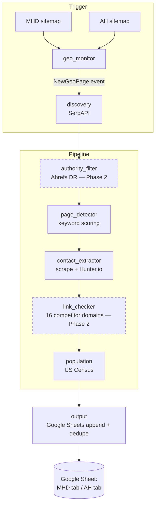

# Architecture

This document mirrors Section 4 of `docs/brief.md` (feasibility report) and is the cross-component reference. When responsibilities, data flow, or external APIs change, update both this file and the relevant module docstrings.

## One-paragraph summary

The pipeline is triggered by a new geo page appearing on MHD or AH. For that geo, we run targeted search queries to find `.gov` and `.edu` sites (and high-DR authority orgs in Phase 2), pick the most relevant department or resource page, extract contact info, check whether the site already links to any of 16 competitor domains, look up population via the US Census API, then append a row to a Google Sheet. The output sheet is what the outreach team works from.

## Components

| # | Component | Responsibility | External dependency |
|---|---|---|---|
| 1 | `geo_monitor` | Poll MHD + AH sitemaps on a schedule, diff against last known set, emit `NewGeoPage` events (city / county / state). | MHD + AH sitemaps |
| 2 | `discovery` | For each new geo, run targeted queries (`"mental health resources site:*.gov" + geo`, etc.) and collect candidate domains. Suffix-filter to `.gov` / `.edu`. | SerpAPI (or Google Custom Search) |
| 3 | `authority_filter` | For non-`.gov`/`.edu` candidates, look up Domain Rating and keep only those above a configured threshold (default DR 40+). Phase 2. | Ahrefs API |
| 4 | `page_detector` | Score candidate URLs by keyword match (e.g. "health", "behavioral", "resources", "probation", "students") + cheap internal-link crawl. Flag low-confidence rows for manual review. | none |
| 5 | `contact_extractor` | Parse the chosen page for email + phone. Fall back to Hunter.io / Apollo when not found. Expected coverage 65–75%. | Hunter.io (and/or Apollo.io) |
| 6 | `link_checker` | Crawl the discovered site for outbound links to any of 16 competitor domains. Phase 2. | none |
| 7 | `population` | Pull population for the geo. | US Census API |
| 8 | `output` | Append row to Google Sheet. Deduplicate by `(domain, geo)`. Separate tabs for MHD vs AH. Flag manual-review rows. | Google Sheets API |

`config.py` and `logging.py` are infra modules used by all of the above; they are not pipeline steps.

## Data flow

Dashed boxes (`authority_filter`, `link_checker`) are Phase 2.

## External APIs

| API | Used by | Cost model | Notes |
|---|---|---|---|
| SerpAPI (or Google Custom Search) | `discovery` | Per query | Rate-limit + cache per geo to control spend. |
| Ahrefs | `authority_filter` | Subscription | Phase 2. DR threshold configurable, default 40. |
| Hunter.io (optionally Apollo) | `contact_extractor` | Per lookup | Fallback only — try direct scrape first. |
| US Census | `population` | Free | Requires an API key; supports city / county / state lookups. |
| Google Sheets | `output` | Free | Service account auth; sheet ID + tab name in config. |

## Concurrency model

- All HTTP I/O is `httpx` async.
- Discovery → page detection → contact extraction happen concurrently per geo, with a bounded `asyncio.Semaphore` to cap simultaneous outbound requests per provider.
- Geos themselves are processed in batches (configurable size) so failures in one geo do not stall the rest.

## Failure handling principles

- Retry transient HTTP failures (5xx, timeouts) with exponential backoff, capped attempts. No silent swallowing.
- Hard failures on a single geo are logged and flagged in the sheet (a row with a status column), not retried indefinitely.
- Idempotency is `(domain, geo)` keyed in the output sheet. Re-runs do not duplicate rows.

## Scope boundaries

- The tool **prospects only**. It does not send outreach emails.
- Contact coverage is realistic, not exhaustive (65–75% expected).
- Manual-review flags are first-class output, not a bug.
